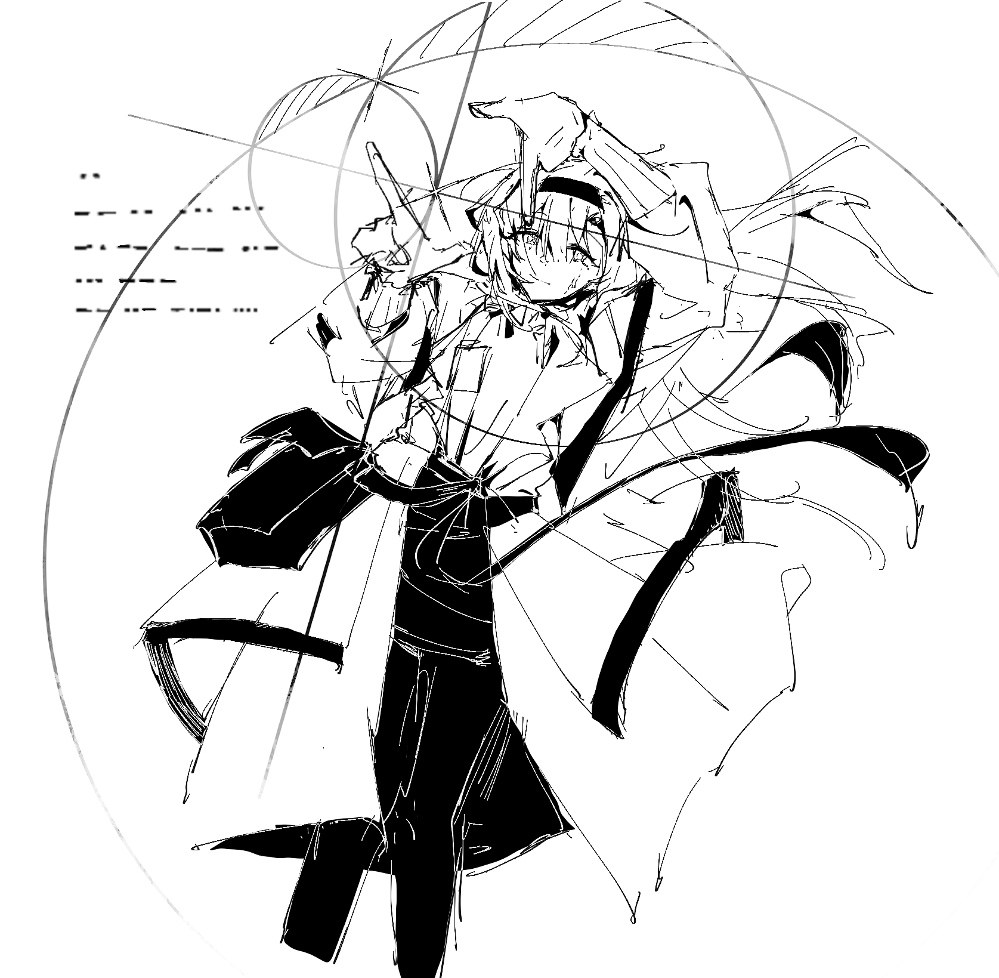

宇宙终焉的余音将会成为我们故事的注脚。{.textkai}

而我会在一切的尽头等待你。{.textkai}

<!-- more -->

先前设定好的时间锚点轻柔地刺激着我的神经，某道熟悉的声纹从几万光年外传来，将我的意识唤回。

将意识下载到空白躯体后总会有那么几分钟的混乱和眩晕，那双灰紫色的双眸是最先出现在我眼前的事物。

“我差点以为你要赶不上了，明明你才是发起人。”声音像是从星河的那头传来一样渺远朦胧，“好在一切顺利，他们也都答应了。”

我张了张嘴，试图让僵硬的声带发出声音。在短暂的尝试后，我说出了第一句话：“他们答应的顺序是什么？

“艾德是最先答应的，你知道的，别看他天天板着个脸，其实他才是喜欢凑热闹的家伙。然后陆也说要来，她说如果艾德过来，那聚餐上一定会有艾德亲手做的菜，因为这是你，唔，这是我们发起的聚会，他不会拒绝露一手的。”普瑞赛斯笑着说道。

“我猜猜，第二个答应的是陆？”你终于将意识拉回肉体，思维速度也重新回归正常，“我记得她那些海里的大朋友们最近进展不错，或许她能有额外的心情参加我们的这次聚会。”

“当然，所以，最后答应的是弗里斯顿。”普瑞赛斯脸上的笑容似乎变淡了一些，“他有些忧心忡忡，看上去他仍然坚持自己之前的想法。”

“没关系。”我坐起身，“对于我们来说，这大概也是最后的一次晚餐。”

我们的文明早已进化到快要忘却了最初的模样，但那些曾经的传说和寓言故事仍然留存在我们的记录当中。

弗里斯顿有时候不太喜欢我突发奇想的那些比喻和命名，不过这一次他默许了我的提议。

“最后的晚餐”。

大概，他也在期待一场终结，和一次新生。

---

和我们预料的一样，弗里斯顿是最先离开的。他总是板着个脸，说着自己的年纪大了熬不了。我和普瑞赛斯对视一眼，然后笑了出来。时间和年龄与我们而言早就已经失去了意义，也亏得弗里斯顿能想到这样的一个借口。

不过我们也都知道他的选择，我们默契地没有提起，而是希望他最后的告别能够平稳度过。

漆黑的“琥珀”是我们可能存在的希望，但保存者计划同样也是。

然后是艾德，天堂支点仍然需要进行最后的调试，他这次过来也更多是想最后再进行一次烹饪，毕竟之后是否能够再次相见还是一个未知数。我们郑重地与他道别，互相许诺在文明重构后让传统的烹饪不再成为失传的技艺。

至于陆，她是最后离开的。她对海里的那些朋友投入了太多的期待，而我和普瑞赛斯都觉得，应当予以他们“文明”以外的自由。

最后的最后，又只剩下了我和普瑞赛斯。

我们之间曾经有过太多交流，到了最后的时刻我还是发现有形的话语太过单薄。

可我看着她的眼睛，读懂了她未尽的言语。

---

 {.centering}

「宇宙终焉的余音将会成为我们故事的注脚。」

「而我，会在一切的尽头等待你。」<eod />

（责任编辑：黒子；网页排版：Baka632；绘图：鹤烟不是二月雪）

<FakeAds />