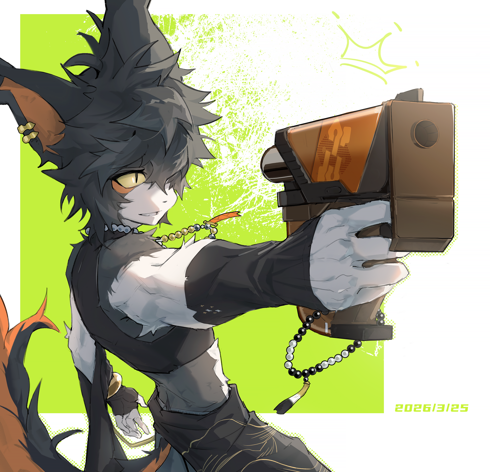

昼短苦夜长，然春分已过，{.textkai}

此后昼渐长，夜渐短。{.textkai}

所以，黑夜总会被春光追上……{.textkai}

所以，生日快乐。{.textkai}

<!-- more -->

## 上

加入罗德岛后的某个三月下旬，阿被派去了炎国某个边陲小镇。和他一起出发的，是医疗部的一个年轻干员。

临行前，华法琳把人叫来特意叮嘱了几句什么。医疗干员点点头，心里却没什么底。医疗部的人都知道阿——窝在实验室里制些味道诡异的药，会和华法琳一起发出令人毛骨悚然的怪笑……和他搭档，怎么看都不是什么好差事。

旁边有人听见了，还偷偷向他投来一个同情的眼神。

但后来，医疗干员回想起这个任务，总觉得有点奇妙。出发前他以为这会是一趟苦差事，回来之后却发现自己对很多东西的看法都变了。他说不清楚具体是什么时候变的……不过，那几天刚好是春分后，之后的白天便开始一天比一天长。

据他的回忆，事情是这样的——

我们是坐夜班火车赶过去的。

三月的炎国，夜里还有些凉。我一上车就看到阿靠在窗边，歪着头看我，嘴角挂着那种似笑非笑的表情。我吞了口口水。

“你紧张什么？”他忽然开口。

“我没紧张。”

“那你攥着任务单那么紧干什么。放轻松，又不会拿你做实验。”

我正要辩解，他自己又补了一句：“放心，死不了。我的医疗事故虽然多，但最近在控制数量了。”

他说完就笑，那种故意吓唬人的笑，眼睛弯弯的，像只坏猫。

我瞪了他一眼，不知道该说什么——医疗部的人刻板印象里都知道他这张嘴，小嘴抹了蜜似的。

果然，见我没反应，他觉得没趣，哼了一声，从随身的包里摸出一个破旧的笔记本。

那本子我见过几次，每次他都藏得严严实实的。这次他倒没藏，翻开来，低头在上面画着什么。我忍不住偷瞄了几眼，密密麻麻的字迹被乱七八糟的涂鸦盖住了——有画的花，有画的猫，还有一碗面……

他察觉到我的目光，抬眼看了我一下，没合上本子，反而把那一页转过来给我看：“怎么样？”

“……挺有风格的。”我说。

他居然笑了，是真的笑了一下。然后低头继续画，嘴里嘟囔着“吽那家伙”“会照顾好自己”什么的。

我忽然想起那些关于他的故事——他爹是黑医，死在黑帮火并的时候，留给他的除了一身本领，更有一堆烂账。

“那本子，”我斟酌着措辞，“记的都是药方？”

“药方，把柄，什么都有。”阿的笔顿了一下，“我爹以为攥着那些把柄就能保命。结果呢？”

他说完，在那朵小花旁边又画了一片叶子，歪歪扭扭的，和花一样丑。

“所以你现在……不干那种事了？”

“什么？”

“‘记把柄’那种。”

阿抬起头，看了我一眼。那一眼里有嘲讽，但不是对我的。

“累不累啊。”他说，“我爹一辈子就毁在那上面。我可不想跟他一样，活那么累，还要管这些恩恩怨怨的。”他顿了顿，声音低下去，“但是有些东西，扔了又觉得可惜。”

他没说是什么东西。但我看着他笔下那朵丑丑的小花，忽然觉得喉咙有点紧。

“你——”

“那种眼神看我是什么意思。”他头也不抬，“我早不琢磨那些了。我现在就是觉得，那本子放着也放着，还不如拿来画画。反正我画得丑，糟蹋了也不心疼。”

他说这话的时候语气很随意，像在说一件不相干的事。

我想说点什么安慰的话，但被他抢了先：“别和我说‘好可怜’之类的话，你要说的话，我不介意现在就拿你做点小实验。”

“……我没想说那个。”

“那就安静。”

我闭嘴了。车厢里静下来，只有笔尖划过纸面的沙沙声和底下车轮与轨道的碰撞声。窗外偶尔闪过远处的灯火，一明一灭的。

过了一会儿，他又开口了，声音比之前轻了很多：“其实也没什么。我爹是蠢，但我也没资格说他。以前我也觉得，手上得攥着点什么才安全。但是偏偏攥得越紧，死得越快。”

“那现在呢？”

“现在？”他把本子合上，抱在怀里，扭头看窗外，“现在有人给我煮面吃。”

窗外黑漆漆的，什么也看不见。但他看了很久，嘴角有一点点翘起来。

小镇依山傍水，一条青石板路从镇头通到镇尾。我们到的时候是清晨，天刚亮，街上却弥漫着一股不安的气氛。好几户人家门窗紧闭，偶尔传来压抑的咳嗽声——不是普通的那种咳，是深一下浅一下的，像咳完就要断气一般。

镇长早就在路口等着，脸色发灰。

“二位大夫，可算来了！”他搓着手，声音颤抖，“这病邪门得很。先是咳，咳个两三天，然后不知道什么时候，人就突然倒下去了。一睡就是好几天，醒来之后什么都不记得，整个人像被抽空了一样。大家都说，是人的魂被抽走了。”

阿没搭话，径直走到一个正昏睡的病人跟前。翻开眼皮，搭了搭脉，又凑近闻了闻病人的气息，眉头皱得很深。

镇长带我去问诊。我们先去了一户人家，一个七八岁的小女孩躺在窄窄的小床上，脸白得像纸。她奶奶坐在床边，牵着她的小手，嘴里翻来覆去就一句话：“囡囡啊，你醒醒，奶奶给你蒸糕吃。”床头柜上放着半块咬了一口的米糕，已经干裂了。镇长小声说，这孩子前天开始咳的，昨天还好好的，今早吃着糕呢，吃着吃着筷子就掉了，人趴在桌上就昏过去了。

我攥着记录本的手紧了紧。又走访了几户，情况大同小异——铁匠铺的当家的咳了两天，昨晚倒的；豆腐坊的老两口一起咳的，老太太今早倒的，老头还在咳，不知道什么时候也会倒下去。家家户户都惶惶不安着。

那种感觉我说不清楚。不是普通的传染病，是一种悬在头顶的、不知道什么时候会落下来的恐惧。每个人都可能成为下一个。

我有些心惊，只是在罗德岛安逸待了一段时间，就快忘记了这片大地上还有多得是的像这样的苦难。

所有病人发病前都去过镇东的集市，在那里买过东西吃——有人吃了糖人，有人喝了茶水，有人买了糕点。症状完全一样：先是咳嗽，然后突然昏睡，醒来后记忆全无。

我记下这些，转头想跟阿商量，却发现人不见了。

“你们那个年轻的大夫，”镇长凑过来，“刚才往东边去了。”

我找到阿的时候，他站在镇东一座废弃的老宅前。宅子塌了一半，院墙长满青苔，门楣上的匾额歪歪斜斜，依稀能看出字迹。阿盯着那扇门，眼神暗了一下。

“认识？”

“以前来过。”阿推开歪斜的门，熟门熟路地绕到后院，推开一间满是灰尘的屋子。里面是药房，药柜空了半边，地上散落着发黄的纸。

他翻了一阵，从一个抽屉里摸出几张方子，看了一眼，脸色变了，手指捏着纸的边缘。

“怎么了？”

“这方子，”他把纸递给我，“是，我爹写的。”

我接过来看，是一张治疗昏睡症的方子，字迹歪歪扭扭。

“这地方，我爹来过。”阿的声音很低，“十几年前，他在这镇上待过一阵。给一个土郎中当过帮手。”

“后来呢？”

“后来我爹发现，那个土郎中往吃的里下药，等人病了再卖药赚钱。我爹劝他收手，他不听。再后来，”阿翻着笔记本，停在一页被涂了的地方，“我爹把他的把柄记下来了。”

他指着那页纸。我凑近看，画着各种咧嘴笑的大头涂鸦底下隐约能辨认出几行字——某年某月，某郎中，以乌头入糖，致人昏睡，卖药解之，获利若干。

“我爹拿着这个去找他，让他别再害人。那土郎中的当时答应得好好的，转头就跑了。我爹以为事情了了，也就没再管。”阿合上本子，声音忽然低了下去，“但是我爹在笔记本里记了一笔，说那方子太烈，解药压不住，劝他换一味药。他没听。”

空气沉默了一会儿。

“我爹还写了一句——‘若剂量过之，恐不可收拾’。”

我们回到镇上，阿把病人的症状又问了一遍，越听脸色越沉，只有嘴角还是嘲弄地咧着。他让我把发病的时间和咳嗽的天数都记下来，画成一张表。我看他对着那张表发了很久的呆。

“不对。”他忽然说。

“什么不对？”

“剂量不对。”他指着表上的数字，“如果是按老方子，咳嗽最多两天就该昏睡了。但现在有的人咳了四天还没倒，有的人咳了一天就倒了——剂量完全不一致。”

他翻着那个笔记本，翻到某一页，停下来，看了很久。

“我爹当年给他的提过一个建议，”他的声音很低，“说乌头这味药，混在不同的吃食里，发效的速度不一样。糖人里发得最快，茶水里最慢。如果要在不同的东西里下药，剂量得分开配，不能一锅端。”

他抬起头，看着我。

“那土郎中的肯定没听全。他可能只记住了‘可以混在不同的吃食里’，没记住剩下的或者根本不想听……管他呢。所以他往糖人、茶水、糕点里加了同样剂量的药——有的发得太快，有的发得太慢，全乱套了。”

“所以这病——”

“不是他控制的。”阿的声音里有一种奇怪的东西，不是愤怒，也不是嘲讽，“他本来想先让人咳嗽，等人来找他买药，再慢慢治。现在剂量乱了，有的人咳两天就倒，有的人咳五天才倒，还带出了并发症，他根本算不清谁该什么时候吃药。解药配不出来，病人越来越多，他自己也慌了。”

“你怎么知道？”

“因为镇上没有卖药的。”阿说，“他如果还想赚钱，早该摆摊卖解药了。没有，说明他自己也治不了。”

他顿了顿，补了一句：“我爹那句话——‘恐不可收拾’——大概就是这种情况。”

我沉默了很久。“那你……能治吗？”

阿没回答。

但他翻着笔记本的手停了下来，停在一页画着一碗面的涂鸦上。他看了几秒，然后把本子合上，塞回包里。

“能。”

我们去找镇长，让他把集市上所有摊贩都查了一遍。果然，糖人摊、糕点摊、茶水摊……几个摊子都有问题。摊主都是同一个人指使的——那人住在镇子北边的山脚下。

我们往北边去的时候，天已经快黑了，只是微微亮。山脚下有一间独门独院的屋子，没开灯。阿让我在门外等着，自己推门进去了。

我躲在窗根底下，透过窗缝往里看。

屋里东西四散凌乱，桌上摊着几包药材，地上搁着一个已经打好包的行李。

“你……你是谁？”

来人是一个五十来岁的男人，瘦削，颧骨很高，正要匆匆忙忙进屋，却看见了在窗子下的我。

“罗德岛的人？”

那人又咽了一口口水，眼睛往窗口瞟了一眼就不知从哪掏出来一把刀就冲进了屋子。

我也冲进去，想都没想就扑在那人前面，对着阿大喊：“回去告诉医疗部的人，俺不是孬种。”

可是阿却很淡定地看着他。

“我听说你在镇上投毒，”阿从包里摸出那排针剂，挑了一支，在手里转了转，“本来想捞一笔，结果剂量没算好，全乱套了，解药也配不出来，是不是？”

那人的脸一阵红一阵白。“你……你怎么知道？”

“我爹当年跟你说的，你一句没听进去。”阿的声音很冷，“他说乌头混在不同吃食里，发效速度不一样，剂量要分开配。你没听。他说那方子太烈，解药压不住，让你换一味。你也没听。最后他在本子上写了一句——‘若剂量过之，恐不可收拾’。”

他顿了顿。

“现在收拾不了了吧？”

那人缩脚往后退了一步，一只手拿着刀比划，另一只手伸向桌子推了就跑。

“这里的人命也不值钱，罗德岛、还有你多管什么闲事！”

阿动了。

他贴着墙根滑出去，速度快得不像话，针剂脱手而出，那人还没来得及跑多远，脖子就被一针扎了下去。

他直挺挺地倒了。

没有昏迷，而是开始笑。那种停不下来的、几乎要把肺咳出来的笑。他的眼睛瞪得老大，想控制自己，但身体不听使唤，只能笑，一直笑。

阿蹲下来，看着他的脸，歪了歪头。

“这药是我自己配的。解药也有，但不是免费的。”他站起来，拍了拍膝盖，“你放心，笑够十二个时辰就停了。死不了。想让别人都昏睡？那你先清醒清醒。”

他转身往外走。走到门口的时候，停了一下，没有回头。

“我爹是死心眼，”他说，“但他说对了一件事——有些账，不能光拿钱算。”

那天晚上，我们住在镇上的小客栈。镇长连夜带人去了山脚下，把那土郎中绑了，从他屋里搜出违规的药材和账本统统上交至警局。听说土郎中被扭送到警局的时候他还在狂笑不止，于是被认为态度不端正从严处理了。

阿在屋里配了一夜的药，第二天天一亮就把解药分给了镇上的病人，也有副作用，就是每个人醒来都会很饿。

那个吃米糕的小女孩是第一批醒过来的。她睁开眼睛，看见她奶奶的脸，愣了一会儿，然后说：“奶奶，我饿了。”

她奶奶抱着她哭了很久。

阿站在门口看了一眼，转身走了。

我追上去的时候，他正站在院子里，盯着墙角一株开得正盛的杏花发呆。他的眼睛下面有很深的黑眼圈，嘴角却有一点点往上翘。

 {.centering}

我忽然想起一件事：今天是3月25日。他的生日。至少档案上这么写的。

我去镇上转了一圈，买了一个糖人，捏成小猫的形状。回来时，阿还站在那株杏花旁边。

“给。”

阿低头看着那只猫。

“生日快乐。”

阿抬起头，眼神里有什么东西闪了一下，又很快熄下去。但他接了。

“……无聊。”他把糖人举到阳光下看了看。

“去山坡上看看吧，”过了一会儿，他说，“听说那边花开得挺好。”

山坡上是一片花海，野生的桃、李、杏，白的粉的挤在一起，风吹过，花瓣像雪一样簌。

## 下

几只蝴蝶在花丛里乱飞。

阿站在花海中间。

虽然有些不合时宜，但是我还是问了：“你以前是不是也经常遇到这样的情况？”

“昼短苦夜长。”他说。

“什么，炎国的古话么？”

“以前一个人的时候，天天盼天亮。可天亮了没多久又黑。那时候想，夜怎么这么长，长到好像永远过不完。”他顿了顿，“后来到了罗德岛，发现这里的人不一样。他们治病，也杀人。他们不是只守着病人等死，也去找那些让病人得病的人。”

“所以你才留下来？”

“我爹那辈子的郎中，只管治病，不管别的。治好了这个，那个又被投了毒。治来治去，人越死越多。所以我以前觉得，医学没用。”他又拿出那本笔记本，但是翻到崭新的一页开始涂鸦。

“那现在呢？”

“还是一样，有些病，不是药能治的。得有人去把背后的人处理干净。”

风吹过来，花瓣落了他一身，他顺势伸了个懒腰。

“春分过了。”我说。

“嗯。”

阿转过头看我，嘴角弯了一下。“你居然知道春分。”

“废话，再怎么我也不是文盲。”

阿笑出了声：“啊这样啊，你说那句‘回去告诉医疗部，俺不是孬种’的时候我还以为你是不要命的莽夫呢。虽然说，只要没死我都能治好就是了，但是也多谢你先挡在前面，要是他真的先拿刀把我捅死了就不好办喽。”

哈哈，这话说的。

唉，“昼短苦夜长”吗，其实我觉得他也不是那种及时行乐的人，一直以来他都很小心翼翼，可能是过去的经历使然吧，总要装作自己能应付一切，还认为自己是坏人。他给自己背负的东西也太多太多，看似不喜欢他爹，可是警示自己同时画下的那些涂鸦，不也正是他自己的记录吗。我知道他和我们治疗普通病症的医生不一样，有更深的思考、有想做的事，希望以后他能在罗德岛找到自己的路……

后来医疗干员提交的事件报告里，备注栏多了一句话。字迹虽比别处潦草些，但像是斟酌了很久：

“昼短苦夜长，然春分已过，此后昼渐长，夜渐短。所以黑夜总会被春光追上。而且，阿真是一名天才。”

报告交上去之后，阿不知道从哪里看到了这一行字。

第二天医疗干员翻开那份归档的任务报告，发现备注栏的空白处多了一个小小的涂鸦——一个的Q版头像，眼神不屑，嘴巴咧得很大，旁边还画了小太阳。<eod />

（责任编辑：黒子；网页排版：Baka632；绘图：KENJI）

<FakeAds />